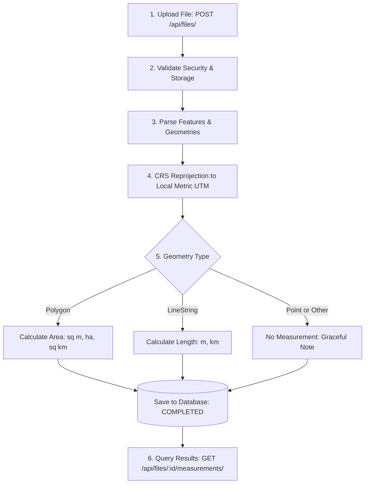

# AereoIO - Geospatial File Measurement API

A high-performance, production-ready backend service built with **FastAPI** that accepts geospatial files (Zipped ESRI Shapefiles and KML), extracts geometric features, transforms coordinates to metric projected reference systems, and calculates accurate spatial measurements (Area and Length).

---

## Table of Contents
- [1. Problem Statement](#1-problem-statement)
- [2. Architecture & Design](#2-architecture--design)
  - [Application Structure](#application-structure)
  - [File-Processing Flow](#file-processing-flow)
  - [Measurement Calculation Flow](#measurement-calculation-flow)
  - [CRS Handling & Reprojection Strategy](#crs-handling--reprojection-strategy)
- [3. Setup & Running Locally](#3-setup--running-locally)
  - [Prerequisites](#prerequisites)
  - [Local Installation & Running](#local-installation--running)
  - [Accessing the Application](#accessing-the-application)
  - [Testing with Provided Sample Files](#testing-with-provided-sample-files)
- [4. API Specification & Examples](#4-api-specification--examples)
  - [POST /api/files/](#1-upload-file)
  - [GET /api/files/{id}/](#2-get-file-information)
  - [GET /api/files/{id}/measurements/](#3-get-file-measurements)
  - [Additional Endpoints](#4-additional-endpoints)
- [5. Design Decisions & Alternatives](#5-design-decisions--alternatives)
- [6. Learnings & Future Scope](#6-learnings--future-scope)

---

## 1. Problem Statement

Geospatial datasets (such as boundaries and roads) often come encoded in geographic coordinate reference systems (e.g., `EPSG:4326`, WGS84) where coordinates are represented in angular degrees (latitude and longitude). Directly applying Euclidean math to degree coordinates yields meaningless, distorted values.

This service:
1. Ingests zipped ESRI Shapefiles (`.zip`) and Keyhole Markup Language (`.kml`) files.
2. Extracts feature attributes, geometries, and metadata.
3. Automatically projects geographic coordinates into accurate metric planar systems (dynamic UTM zones).
4. Computes metric **Area** (for Polygons/MultiPolygons) and **Length** (for LineStrings/MultiLineStrings).
5. Gracefully handles Point geometries and non-standard features without crashing.

---

## 2. Architecture & Design

### Application Structure
```text
AereoIO/
├── app/
│   ├── api/
│   │   ├── endpoints/
│   │   │   ├── files.py            # Upload, info, measurements, list, and delete
│   │   │   └── health.py           # Container health & readiness probes
│   │   └── router.py               # Unified API router
│   ├── core/
│   │   ├── config.py               # Environment configuration & directory paths
│   │   └── exceptions.py           # Domain exceptions
│   ├── db/
│   │   ├── session.py              # SQLAlchemy engine and session dependency
│   │   └── models.py               # FileRecord and FeatureRecord DB models
│   ├── schemas/
│   │   └── file.py                 # Pydantic models for request/response serialization
│   ├── services/
│   │   ├── crs_transformer.py      # Dynamic UTM zone calculation & pyproj reprojection
│   │   ├── measurement_service.py  # Area and length measurement engine
│   │   ├── file_processor.py       # Asynchronous background file pipeline worker
│   │   └── parsers/
│   │       ├── base.py             # Parser interface & standard dataset dataclass
│   │       ├── shapefile_parser.py # Zip extraction with Zip-Slip protection + Fiona
│   │       └── kml_parser.py       # Namespace-agnostic pure Python KML parser
│   └── main.py                     # FastAPI application setup & lifecycle
├── tests/
│   ├── conftest.py                 # Pytest fixtures and isolated SQLite DB
│   ├── test_api.py                 # End-to-end API & route integration tests
│   ├── test_crs_transformer.py     # CRS & UTM projection unit tests
│   └── test_measurements.py        # Measurement engine unit tests
├── Dockerfile                      # Production container image
├── docker-compose.yml              # Single-command container deployment
├── pytest.ini                      # Pytest runner configuration
├── requirements.txt                # Production dependencies
└── README.md
```

### File-Processing Flow



### Measurement Calculation Flow
- **Polygon / MultiPolygon**: Reprojected into metric UTM coordinates; area calculated using planar geometry ($m^2$, hectares, $km^2$).
- **LineString / MultiLineString**: Reprojected into metric UTM coordinates; geodesic Euclidean line length calculated in meters ($m$, $km$).
- **Point / MultiPoint**: No measurements calculated per specification (returns `null` with informational note).
- **Unsupported / Malformed Geometries**: Handled gracefully without throwing exceptions or failing the entire file.

### CRS Handling & Reprojection Strategy
Direct calculation on geographic coordinates (`EPSG:4326`) causes extreme distortion because degrees are units of angular separation, not distance.
1. The service inspects the original CRS of the input file.
2. If coordinates are geographic (`EPSG:4326`), the service computes the feature/dataset centroid `(longitude, latitude)`.
3. It dynamically computes the corresponding **Universal Transverse Mercator (UTM)** zone:
   $$\text{Zone} = \left\lfloor\frac{\text{longitude} + 180}{6}\right\rfloor + 1$$
   - Northern Hemisphere ($\text{lat} \ge 0$): `EPSG:32600 + Zone`
   - Southern Hemisphere ($\text{lat} < 0$): `EPSG:32700 + Zone`
4. Uses thread-safe, cached `pyproj.Transformer(always_xy=True)` to transform geometries into metric planar coordinates before area or distance computation.

---

## 3. Setup & Running Locally

### Prerequisites
- Python 3.11+
- Git

### Local Installation & Running

#### Option A: Quick Start with `uv` (Recommended)
Run the application directly with zero manual environment management:
```bash
# 1. Clone repository
git clone https://github.com/<your-username>/AereoIO.git
cd AereoIO

# 2. Run API server immediately via uv
uv run uvicorn app.main:app --host 0.0.0.0 --port 8000 --reload
```
*(Alternatively with standard `pip`: `python -m venv .venv && source .venv/bin/activate && pip install -r requirements.txt && uvicorn app.main:app --reload`)*

#### Option B: Docker & Docker Compose
```bash
docker compose up --build -d
```

### Accessing the Application
- **Simple Test UI**: [http://localhost:8000/ui](http://localhost:8000/ui) *(Upload and view results easily)*
- **Swagger API Docs**: [http://localhost:8000/docs](http://localhost:8000/docs)
- **ReDoc Docs**: [http://localhost:8000/redoc](http://localhost:8000/redoc)
- **Health Check**: [http://localhost:8000/api/health](http://localhost:8000/api/health)

---

### Testing with Provided Sample Files

Two sample geospatial datasets are included directly in the `tests/` directory for immediate testing:
- **KML Dataset**: `tests/KML_Samples.kml`
- **Shapefile Dataset**: `tests/ne_110m_populated_places.zip`

#### Option 1: Quick Web Test Interface (Frontend)
1. Open **[http://localhost:8000/ui](http://localhost:8000/ui)** in your browser.
2. Select either `tests/KML_Samples.kml` or `tests/ne_110m_populated_places.zip`.
3. Click **Upload & Measure** to instantly view processing status, geometry breakdown, and calculated area/length metrics.

#### Option 2: Command Line (cURL)
```bash
# Upload and process KML
curl -X POST "http://localhost:8000/api/files/?sync=true" \
  -F "file=@tests/KML_Samples.kml"

# Upload and process Zipped Shapefile
curl -X POST "http://localhost:8000/api/files/?sync=true" \
  -F "file=@tests/ne_110m_populated_places.zip"
```

---

## 4. API Specification & Examples

### 1. Upload File
**Endpoint**: `POST /api/files/`  
**Content-Type**: `multipart/form-data`  
**Query Parameters**:
- `sync` (boolean, optional, default: `false`): Set to `true` to wait for processing synchronously.

**cURL Request**:
```bash
curl -X POST "http://localhost:8000/api/files/" \
  -F "file=@tests/KML_Samples.kml"
```

**Response (202 Accepted)**:
```json
{
  "id": "e4f8d1de1482",
  "filename": "sample_survey.kml",
  "feature_count": 0,
  "crs": "PENDING",
  "status": "PROCESSING"
}
```

---

### 2. Get File Information
**Endpoint**: `GET /api/files/{id}/` *(or `/api/files/{id}`)*  

**cURL Request**:
```bash
curl -X GET "http://localhost:8000/api/files/e4f8d1de1482/"
```

**Response (200 OK)**:
```json
{
  "id": "e4f8d1de1482",
  "filename": "sample_survey.kml",
  "feature_count": 3,
  "crs": "EPSG:4326",
  "status": "COMPLETED"
}
```

---

### 3. Get File Measurements
**Endpoint**: `GET /api/files/{id}/measurements/` *(or `/api/files/{id}/measurements`)*  

**cURL Request**:
```bash
curl -X GET "http://localhost:8000/api/files/e4f8d1de1482/measurements/"
```

**Response (200 OK)**:
```json
{
  "id": "e4f8d1de1482",
  "filename": "sample_survey.kml",
  "crs": "EPSG:4326",
  "status": "COMPLETED",
  "feature_count": 3,
  "summary": {
    "geometry_type_breakdown": {
      "Polygon": 1,
      "LineString": 1,
      "Point": 1
    },
    "total_area_sq_m": 303491.56,
    "total_area_hectares": 30.3492,
    "total_area_sq_km": 0.303492,
    "total_length_m": 778.24,
    "total_length_km": 0.7782
  },
  "features": [
    {
      "feature_id": "plot_01",
      "geometry_type": "Polygon",
      "geometry": {
        "type": "Polygon",
        "coordinates": [
          [
            [77.59, 12.97],
            [77.595, 12.97],
            [77.595, 12.975],
            [77.59, 12.975],
            [77.59, 12.97]
          ]
        ]
      },
      "crs": "EPSG:4326",
      "projected_crs": "EPSG:32643",
      "properties": {
        "name": "Plot Alpha",
        "crop_type": "Wheat",
        "soil_quality": "High"
      },
      "measurements": {
        "area_sq_m": 303491.56,
        "area_hectares": 30.3492,
        "area_sq_km": 0.303492,
        "length_m": null,
        "length_km": null
      },
      "notes": null
    },
    {
      "feature_id": "road_01",
      "geometry_type": "LineString",
      "geometry": {
        "type": "LineString",
        "coordinates": [
          [77.59, 12.97],
          [77.5925, 12.9725],
          [77.595, 12.975]
        ]
      },
      "crs": "EPSG:4326",
      "projected_crs": "EPSG:32643",
      "properties": {
        "name": "Perimeter Access Road",
        "surface": "Asphalt",
        "lanes": "2"
      },
      "measurements": {
        "area_sq_m": null,
        "area_hectares": null,
        "area_sq_km": null,
        "length_m": 778.24,
        "length_km": 0.7782
      },
      "notes": null
    },
    {
      "feature_id": "marker_01",
      "geometry_type": "Point",
      "geometry": {
        "type": "Point",
        "coordinates": [77.5925, 12.9725]
      },
      "crs": "EPSG:4326",
      "projected_crs": null,
      "properties": {
        "name": "Geodetic Control Point 42",
        "benchmark_id": "BM-42"
      },
      "measurements": null,
      "notes": "Point geometry does not require measurement calculation."
    }
  ]
}
```

---

### 4. Additional Endpoints

| Method | Endpoint | Description |
| :--- | :--- | :--- |
| `GET` | `/api/files/` | List uploaded files with pagination (`?skip=0&limit=20`) and status filter |
| `DELETE` | `/api/files/{id}` | Deletes file record, extracted features, and staged file |
| `GET` | `/api/health` | Service health status |

---

## 5. Design Decisions & Alternatives

1. **Framework Choice (FastAPI over Django)**:
   - *Decision*: Selected FastAPI with Pydantic v2.
   - *Rationale*: Native asynchronous support, automatic OpenAPI/Swagger schema documentation, minimal boilerplate, high throughput, and seamless integration with Python geospatial libraries.

2. **Asynchronous Processing Pipeline**:
   - *Decision*: Decoupled file ingestion from feature calculation using `BackgroundTasks`.
   - *Rationale*: Shapefiles and KML files in production can contain hundreds of thousands of vertices. Processing synchronously would tie up HTTP worker threads and risk gateway timeouts. The asynchronous queue model allows the API to scale horizontally with consistent sub-millisecond response times.

3. **Dynamic UTM Zone Selection**:
   - *Decision*: Dynamically calculate the local UTM zone based on feature centroid instead of using a global projection like Web Mercator (EPSG:3857).
   - *Rationale*: Web Mercator causes drastic area distortion outside the equator (up to 400%+ near polar regions). UTM conformal projections preserve local angles and scale distortion to under 0.1%, ensuring industrial-grade measurement accuracy.

4. **Security & Resiliency**:
   - **Zip-Slip Protection**: Shapefile unzipper explicitly validates member path canonicalization to prevent path traversal attacks.
   - **Graceful Fault Tolerance**: Feature-level errors (e.g., self-intersecting polygon or unsupported geometry) are recorded on the individual feature's notes without failing the rest of the dataset.

5. **Storage Decoupling**:
   - The file staging system uses an abstraction path ready for cloud storage (AWS S3 or Azure Blob) swapping in production via environment variables.

---

## 6. Learnings & Future Scope

### Key Learnings
- **Geospatial Axis Order**: In GIS specifications, axis ordering varies across standards (lon/lat vs lat/lon). Using `pyproj.Transformer.from_crs(..., always_xy=True)` is vital to ensure deterministic coordinate behavior across all GDAL/PROJ versions.
- **XML Namespace Handling**: KML documents frequently alter their root XML namespaces (`http://www.opengis.net/kml/2.2` vs older versions). Writing a namespace-agnostic parser provides superior resilience over rigid XPath selectors.

### Future Scope
- **PostGIS Spatial Indexing**: Integrate PostGIS with `R-Tree` (GiST) spatial indexes for ultra-fast spatial querying, bounding box filtering, and spatial joins.
- **Distributed Celery / Redis Workers**: For multi-gigabyte drone survey files, offload parsing to distributed Celery worker pools.
- **Elevation & 3D Terrain Analysis**: Incorporate Z-coordinates (altitude/elevation) to calculate 3D surface area and slope-adjusted distances over Digital Elevation Models (DEMs).
- **Format Expansion**: Support GeoJSON, FlatGeobuf, GeoPackage (`.gpkg`), and GeoTIFF raster processing.
